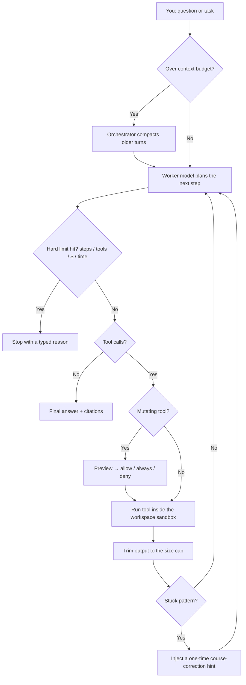

# Cozmo: A Coding Agent for Your Terminal

Cozmo is a coding agent that runs in your terminal, inside your own repository. It finds the right code with hybrid search, reads only the lines it needs, asks before it writes a file or runs a command, and stops itself before it burns through your budget. The agent loop is written from scratch. There is no LangChain.

[](https://github.com/ShashwatXD/cozmo/actions/workflows/ci.yml)
[](https://pypi.org/project/cozmo-agent/)
[](https://www.python.org/)
[](./LICENSE)


```bash
pipx install cozmo-agent
cd ~/your-project
cozmo
```

## Overview

Most coding agents either hide the loop behind a framework or paste whole files into the prompt until the context window fills up. Cozmo takes the opposite approach. **You own the loop**, and the harness decides how many bytes go back into the model.

It is built around three rules:

1. **Find before you read.** Exact names go through ripgrep. Vague questions go through hybrid semantic search. Files are read in line ranges, not whole.
2. **Nothing mutating runs without consent.** Writes, shell commands and MCP tools ask first, and you choose *allow once*, *always allow* or *deny*.
3. **Every run has hard limits.** Steps, tool calls, dollars and wall-clock time are all capped, and a stuck detector warns and then stops repeating tool loops.
4. **If you cannot measure it, it is not done.** Every model and tool call is traced, and offline evals test capability, safety and failure handling in CI.

## Core Features

| Feature | Description |
|---|---|
| **Owned ReAct Loop** | A plain Python agent loop: model → tool calls → observations → repeat, with a typed stop reason on every run. |
| **Hybrid Code Search** | BM25 and embeddings fused with Reciprocal Rank Fusion, then a lexical reranker. Benchmarked below. |
| **Multi-Model Routing** | An *orchestrator* model for compaction, team planning and synthesis, and an optional cheaper *worker* model that runs the tool loop. |
| **Subagents and Teams** | `run_subtask` sends out a read-only child agent that returns a compact evidence pack. `run_team` runs a director → researcher/coder/reviewer → synthesizer pipeline. |
| **Permission Gate** | Diff preview before writes, the full command before shell, approval for MCP tools. Chained shell commands never match an allow rule. |
| **Repo Trust** | Settings that could run code or redirect your key only apply after `cozmo trust`, and are pinned to the file's hash. |
| **Guardrails** | Hard stops on steps, tool calls and time per turn, plus one cost ledger for the whole session including subagents. Old tool output is trimmed during a turn and older turns are summarized between turns. |
| **Stuck Detector** | Spots repeated identical calls, repeated identical errors and A/B ping-pong, gives the model one hint, then stops the run. |
| **Observability** | Nested spans for every turn, model call, tool and approval. `cozmo trace` shows one run as a tree and `cozmo stats` shows health over time. |
| **Agent Evals** | `cozmo eval` runs task, safety and chaos suites offline. Add `--live --repeat 5` for real-model pass rates, and `--baseline` to catch regressions. |
| **Crash Recovery** | Each step is checkpointed. `/continue` restores an unfinished turn with its tool results. |
| **Modes** | `/ask` (read-only explain), `/plan` (explore, then propose) and `/agent` (full tools). |
| **Sessions** | Every turn is logged as JSONL, with an intent record before each side effect. `/export md\|json` writes an audit trail and `search_history` searches past turns. |
| **MCP Client** | Connects any Model Context Protocol server over stdio. Its tools appear as `mcp__{server}__{tool}`. |
| **Groundedness Check** | An eval-time check of claims and `path:line` citations against the code that was actually retrieved. It uses word overlap, so treat it as a cheap regression signal. |
| **Any Provider** | OpenAI, Anthropic, OpenRouter, Ollama, or any OpenAI-compatible `base_url`. Bring your own key. |

## How It Works



**Retrieval** (the `semantic_search` tool):

1. **Index.** Files are split into overlapping chunks of about 600 characters on line boundaries, embedded in batches that span files, and stored in Chroma. Only files whose content hash changed are re-embedded.
2. **Recall.** A query runs through BM25 (inverted index with identifier sub-word splitting, so `detect_stuck` also matches "stuck") and cosine vector search. The two lists are fused with Reciprocal Rank Fusion.
3. **Rerank.** The fused rank is kept as the main signal. It is refined with exact-match, content-word and path evidence.
4. **Expand.** Each hit is padded with surrounding source lines and returned as `path:start-end`.

## Benchmarks

All numbers below are reproducible with `python benchmarks/run_retrieval.py`. The corpus is Cozmo's own source at a pinned commit (97 files, 634 chunks), searched with **43 hand-labeled queries**: 28 natural-language questions and 15 identifier lookups. A query counts as a hit at *k* if a correct file appears in the top *k* distinct files. Embeddings come from local Ollama `nomic-embed-text`.

**Production pipeline (`semantic_search`), before and after the engineering pass:**

| Metric | Before | After |
|---|---|---|
| Recall@1 | 0.56 | **0.79** |
| Recall@5 | 0.93 | **0.98** |
| MRR@10 | 0.708 | **0.868** |
| `semantic_search` latency, p50 | 64.4 ms | **2.5 ms** |

**By strategy (after):**

| Strategy | R@1 | R@5 | MRR@10 | p50 |
|---|---|---|---|---|
| BM25 only | 0.44 | 0.98 | 0.664 | 0.16 ms |
| Vector only | 0.72 | 0.93 | 0.811 | 0.07 ms |
| Hybrid (RRF) | 0.74 | 0.93 | 0.834 | 0.53 ms |
| **Hybrid + rerank** | **0.79** | **0.98** | **0.868** | 2.5 ms |

What changed:

- **Reranker.** The old reranker multiplied the fused score by 0.15. RRF scores are around 0.03, so the hybrid ranking was effectively thrown away and the final order was purely lexical. The pipeline scored *below* plain hybrid search. The rerank now keeps the fused rank as its prior.
- **Latency.** BM25 used to be rebuilt over the whole repository on every tool call. It is now an inverted index cached per store version. Vector search was a pure-Python loop and is now a single numpy matrix-vector product.
- **Indexing.** Embedding requests are batched across files instead of one or more per file. A failing file is retried on its own so it cannot break the rest.

Latency uses an in-memory store with cached query embeddings, so it measures retrieval alone. A live search also pays for one embedding request. The 43 queries were also used while tuning, so treat the scores as a regression signal for this repository.

Raw reports are in [`benchmarks/results/`](benchmarks/results). CI runs the same benchmark offline with a deterministic stub embedder as a quality gate, so lexical, fusion and rerank regressions fail the build.

## Tech Stack

- **Language**: Python 3.11+
- **CLI**: Typer, Rich, questionary
- **LLMs**: OpenAI SDK (OpenAI / OpenRouter / Ollama / compatible), Anthropic Messages API over httpx
- **Retrieval**: Chroma (HNSW), numpy, a custom BM25 inverted index, Reciprocal Rank Fusion
- **Reliability**: tenacity retries with `retry-after` support, pydantic-settings
- **Tooling**: ripgrep, Model Context Protocol (`mcp`)
- **Quality**: pytest (209 tests), ruff, mypy, a coverage gate, and GitHub Actions on Python 3.11–3.13

## Project Structure

```
cozmo/
├── src/cozmo/
│   ├── domain/              # pure rules and types: messages, guardrails, events, ports
│   ├── app/                 # use-cases: agent loop, compaction, subagents, teams,
│   │                        #   permissions, stuck detector, groundedness, evals
│   ├── search/              # hybrid BM25 + vector search, rerank, context expansion
│   ├── infra/
│   │   ├── llm/             # OpenAI-compatible + Anthropic adapters, retries, model catalog
│   │   ├── rag/             # chunking, incremental indexer, Chroma / JSON vector stores
│   │   ├── tools/           # tool registry, sandbox, ripgrep search, permission store
│   │   ├── history/         # JSONL session store + history search
│   │   ├── mcp/             # MCP client manager and tool registration
│   │   └── telemetry/       # structured traces
│   ├── cli/                 # Typer entrypoint, REPL, setup wizard
│   └── prompts/             # versioned system prompts per mode and role
├── benchmarks/              # labeled retrieval queries, runner, saved results
├── tests/                   # unit, integration (real MCP server) and CLI tests
└── website/                 # project site
```

`domain` holds pure rules and types and imports nothing from the other layers or any SDK, which a test enforces. `app` composes `infra` directly at a few seams.

## Getting Started

### Prerequisites

- Python 3.11 or newer
- An API key for OpenAI, Anthropic or OpenRouter, **or** [Ollama](https://ollama.com) running locally
- Optional: [ripgrep](https://github.com/BurntSushi/ripgrep) for faster exact search (Cozmo falls back to Python without it)

### 1. Install

```bash
pipx install cozmo-agent              # recommended
# or: pip install cozmo-agent
pip install "cozmo-agent[mcp]"        # optional: MCP tool servers
```

The package on PyPI is `cozmo-agent`. The command is `cozmo`.

### 2. Configure

```bash
cozmo setup
```

Pick a provider, paste your key and choose a model. Settings go to `~/.cozmo/config.json`, which is readable only by you. You can also set `COZMO_PROVIDER`, `COZMO_MODEL` and `COZMO_API_KEY` as environment variables.

### 3. Run

```bash
cd ~/your-project
cozmo                       # interactive agent
cozmo -m "why does add() return the wrong value?"   # one shot
cozmo --ask                 # read-only explain mode
cozmo --plan                # explore, then propose
```

The first launch indexes the repository into `.cozmo/`. Later launches only re-embed files that changed.

## Usage

**REPL commands**

| Command | Action |
|---|---|
| `/ask` `/plan` `/agent` | Switch mode |
| `/sessions` | List recent sessions |
| `/continue [id]` | Resume a session (latest if no id) |
| `/export md\|json` | Export the session audit trail |
| `/compact` | Summarize older turns now |
| `/clear` | Reset conversation memory |
| `/config` `/setup` | Show config path / re-run setup |
| `/exit` | Quit |

Each turn ends with a footer showing tokens, estimated cost, `ctx≈N/budget`, steps and the stop reason.

**Commands**

| Command | Description |
|---|---|
| `cozmo` / `cozmo agent` | Interactive agent |
| `cozmo chat` | Plain chat, no tools |
| `cozmo index` | Rebuild the code index |
| `cozmo eval` | Golden, task, safety and chaos evals. Options: `--live`, `--repeat`, `--json`, `--baseline`, `--record`, `--replay` |
| `cozmo trace [id\|last]` | List recent turns, or show one as a span tree |
| `cozmo stats` | Completion rate, latency, cost, tool errors and approvals |
| `cozmo trust` | Allow this repo's `.cozmo` config, permissions and `.env` |
| `cozmo doctor` | Show the effective settings |
| `cozmo config --show` | Print config (keys masked) |

<details>
<summary><b>Configuration reference</b></summary>

Precedence, highest first: CLI flags → `COZMO_*` env → `.env` → `<repo>/.cozmo/config.json` → `~/.cozmo/config.json` → defaults.

A repo is untrusted until you run `cozmo trust`. Until then its config can only set harmless options such as `model` and `temperature`, its `.env` cannot change `base_url`, `allow_shell`, `allow_write` or `mcp_servers`, and its saved allow rules are ignored. Editing a trusted file ends the trust for that file.

For `max_cost_usd`, Cozmo stops rather than guess when a model has no known price. Add one with `"model_prices": {"model-name": [input_per_1m, output_per_1m]}`.

```json
{
  "provider": "openai",
  "model": "gpt-4o",
  "worker_model": "gpt-4o-mini",
  "allow_write": true,
  "allow_shell": false,
  "max_agent_steps": 8,
  "max_tool_calls_per_session": 40,
  "max_cost_usd": 0.50,
  "session_timeout_s": 600,
  "context_token_budget": 24000,
  "vector_backend": "chroma"
}
```

| Path | Contents |
|---|---|
| `<repo>/.cozmo/chroma/`, `index.json` | Code vector index |
| `<repo>/.cozmo/history/*.jsonl` | Session events |
| `<repo>/.cozmo/permissions.json` | Saved allow / deny rules |
| `<repo>/.cozmo/traces.jsonl` | Spans for model calls, tools and approvals (no file contents) |
| `<repo>/.cozmo/checkpoints/` | Recovery point for an unfinished turn |
| `~/.cozmo/trust.json` | Hashes of repo files you have trusted |

</details>

<details>
<summary><b>Connecting MCP servers</b></summary>

Add to `~/.cozmo/config.json` or `<repo>/.cozmo/config.json`:

```json
"mcp_servers": [
  {
    "name": "filesystem",
    "transport": "stdio",
    "command": "npx",
    "args": ["-y", "@modelcontextprotocol/server-filesystem", "/path/to/allowed"]
  }
]
```

A server that fails to start is skipped with a warning, and the others still connect. MCP tools ask for approval, and are blocked in `/ask` and `/plan`. Servers listed in a repo's own config need `cozmo trust`. Set `COZMO_MCP_DISABLED=1` to turn MCP off.
</details>

## Development

```bash
git clone https://github.com/ShashwatXD/cozmo.git
cd cozmo
python3 -m venv .venv && source .venv/bin/activate
pip install -e ".[dev,mcp]"

pytest --cov=cozmo                     # 209 tests, offline, coverage gate at 75%
ruff check . && ruff format --check .  # lint + format
mypy                                   # type-check
cozmo eval                             # golden agent eval
python benchmarks/run_retrieval.py --embedder ollama   # retrieval benchmark
```

Set `COZMO_DEBUG_CURL=1` to print each LLM request as a ready-to-run `curl` command (keys redacted).

## Privacy

- Your code index, sessions and permissions stay in `.cozmo/` inside your repository. Your key stays in `~/.cozmo/config.json`, readable only by you.
- File tools cannot leave the workspace root or write inside `.git/` or `.cozmo/`.
- Shell access is off until you turn it on. Commands run in the workspace without credential environment variables, but they are not sandboxed, so review them before approving. Use a container for untrusted repositories.
- Code is sent only to the model provider you configured. With Ollama, nothing leaves your machine.

## Contributing

Issues and pull requests are welcome. Please run `pytest`, `ruff check .` and `mypy` before opening a pull request.

## License

MIT. Named after Anki's Cozmo robot. This is an unaffiliated fan project.
