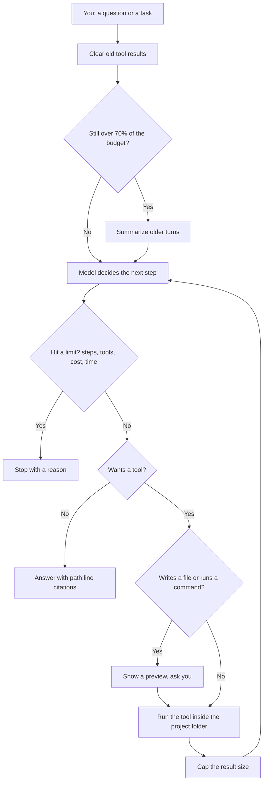

# Cozmo: A Coding Agent for Your Terminal

Cozmo is a coding agent that runs in your terminal, inside your own repository. It starts with almost nothing in its context and lets the model pull in only what the task needs: it searches first, reads the lines that matter, asks before it changes anything, and stops itself before it runs past its budget. The agent loop is plain Python. There is no LangChain.

[](https://github.com/ShashwatXD/cozmo/actions/workflows/ci.yml)
[](https://pypi.org/project/cozmo-agent/)
[](https://www.python.org/)
[](./LICENSE)


```bash
pipx install cozmo-agent
cd ~/your-project
cozmo
```

## Overview

Many coding agents paste whole files into the prompt and keep them there until the context window fills up. Cozmo does the opposite: **the model fetches context when it needs it, and the harness decides how much of it stays.**

It is built around three rules:

1. **Find, then read a window.** Exact names go through ripgrep, vague questions through hybrid search, and files are read in line ranges. Large files without a range return only their first lines and their size.
2. **Old results make room for new ones.** Before each turn, older tool results become a one-line note. If the model needs one again, it calls the tool again and gets the current version.
3. **Nothing risky without consent, nothing unbounded.** Writes and shell commands show a preview first. Steps, tool calls, cost and time all have hard limits.

## Core Features

| Feature | Description |
|---|---|
| **Own Agent Loop** | Model → tool calls → results → repeat, in plain Python, with a clear stop reason on every run. |
| **Hybrid Code Search** | Keyword search (BM25) and embeddings, merged and re-ranked. Benchmarked below. |
| **Context on Demand** | Small defaults, fresh file reads for every search hit, and old tool results cleared before anything is summarized. |
| **Permission Gate** | A diff before every write and the full command before every shell call: allow once, always allow, or deny. Saved per project. |
| **Guardrails** | Hard stops on steps, tool calls, cost in USD and session time. A stuck detector catches repeated calls and repeated errors. |
| **Subagents and Teams** | `run_subtask` sends a read-only helper that returns a short evidence pack. `run_team` splits large tasks across director, researcher, coder and reviewer roles. |
| **Two Models** | A strong model for planning and summaries, and an optional cheaper model for tool calls. |
| **Modes** | `/ask` explains, `/plan` explores and proposes, `/agent` makes changes. |
| **Sessions** | Every turn is logged. Resume with `/continue`, export with `/export`, and search past sessions with `search_history`. |
| **MCP Client** | Connects any Model Context Protocol server. Its tools appear as `mcp__{server}__{tool}`. |
| **Groundedness Check** | Scores every answer: are its claims and `path:line` citations backed by code that was actually read? |
| **Trace Dashboard** | `cozmo trace` (or `/trace`) opens a local page with every turn, each model call and tool call in full, and saved eval runs. |
| **Any Provider** | OpenAI, Anthropic, Gemini, OpenRouter, Ollama, or any OpenAI-compatible endpoint. Bring your own key. |

## How It Works



1. **Clear.** Before each turn, tool results older than the newest six become a note like `[cleared to save context] read_file(path="app.py", start_line=40) returned 6,120 chars here earlier. Call it again if you still need the result.` No model call is needed.
2. **Summarize, only if needed.** If the conversation is still over 70% of its token budget, the planning model summarizes older turns.
3. **Decide.** The model picks the next tool: `search_repo` for exact names, `semantic_search` for ideas, `read_file` for a window of lines.
4. **Check.** Every step checks the limits. Writes and shell commands wait for your answer.
5. **Run and cap.** The tool runs inside the project folder only, and its output is cut to a size cap.
6. **Answer.** When the model needs no more tools, it answers and cites the lines it read.

### How search finds code

1. **Index.** Files are split into chunks of about 600 characters and embedded once. Later runs re-embed only files whose content changed.
2. **Recall.** A query runs through keyword search (identifiers are split, so `detect_stuck` also matches "stuck") and vector search, and the two lists are merged with Reciprocal Rank Fusion.
3. **Re-rank.** The merged order is refined with exact-match, content-word and file-path evidence.
4. **Read fresh.** Each hit is padded with nearby lines read from the file **as it is now**, so code changed during the session is never shown in its old form. Hits from files changed since indexing are marked so the model re-reads them.

## Tracing and Evals

Every turn is written to `.cozmo/traces.jsonl`: the question, each model request (the messages sent, the reply, the tools it asked for, tokens, cost, time, finish reason), each tool call (arguments and the exact result the model saw), anything the harness did to the context, and how the turn ended. Each answer also gets a **groundedness score**: how many of its claims and `path:line` citations are backed by what was read in that turn. It is computed locally, with no extra model call.

```bash
cozmo trace          # open the dashboard for this repository (or /trace inside the REPL)
cozmo eval           # golden tasks + groundedness cases, offline
cozmo eval --live    # the same tasks against your configured model
```

The dashboard runs on `localhost` only and reads the files fresh on every refresh. It shows:

- **Turns**: time, model, model calls, tool calls and errors, tokens, cost, groundedness, and how each turn stopped. A reply that hit the output limit is marked **cut off**.
- **Steps**: open a turn for its timeline, then **Show more details** on any step for the full request, reply or tool result.
- **Evals**: every `cozmo eval` run is saved to `.cozmo/evals/`, with each case's result, time and tokens, and a link to its trace.

The traces have already caught real problems. With Gemini, an answer stopped mid-sentence with `finish: length` after only 72 visible tokens: thinking had used up the output limit. Cozmo now gives Gemini a larger limit with low reasoning effort, counts thinking tokens as output so cost is right, and marks any cut-off answer instead of reporting it as complete.

## Benchmarks

Reproduce with `python benchmarks/run_retrieval.py`. The corpus is Cozmo's own source at a pinned commit (97 files, 634 chunks), searched with **43 hand-labeled queries**: 28 questions in plain language and 15 identifier lookups. A query is a hit at *k* if a correct file is in the top *k* files. Embeddings come from local Ollama `nomic-embed-text`.

| Metric | Before tuning | After tuning |
|---|---|---|
| Recall@1 | 0.56 | **0.79** |
| Recall@5 | 0.93 | **0.98** |
| MRR@10 | 0.708 | **0.868** |
| `semantic_search` latency, p50 | 64.4 ms | **2.5 ms** |
| Embedding requests to index the corpus | 99 | **10** |

| Strategy | R@1 | R@5 | MRR@10 | p50 |
|---|---|---|---|---|
| Keywords only (BM25) | 0.44 | 0.98 | 0.664 | 0.16 ms |
| Vectors only | 0.72 | 0.93 | 0.811 | 0.07 ms |
| Both, merged (RRF) | 0.74 | 0.93 | 0.834 | 0.53 ms |
| **Both + re-rank** | **0.79** | **0.98** | **0.868** | 2.5 ms |

What made the difference:

- **Re-ranker.** The old re-ranker scaled the merged score by 0.15, which threw the merged order away. It now keeps that order as its starting point.
- **Speed.** Keyword search used to rebuild its index on every call; it is now cached. Vector search went from a Python loop to one numpy operation.
- **Indexing.** Embedding requests are batched across files, and a failing file is retried on its own.

Raw results are in [`benchmarks/results/`](benchmarks/results). CI runs the same benchmark offline with a deterministic embedder, so a ranking regression fails the build.

## Tech Stack

- **Language**: Python 3.11+
- **CLI**: Typer, Rich, questionary
- **Models**: OpenAI SDK (OpenAI, Gemini, OpenRouter, Ollama, compatible endpoints), Anthropic Messages API over httpx
- **Search**: ripgrep, a custom BM25 index, Chroma, numpy, Reciprocal Rank Fusion
- **Reliability**: tenacity retries that respect `retry-after`, pydantic-settings
- **Tools**: Model Context Protocol (`mcp`)
- **Observability**: JSONL traces, a groundedness scorer, saved eval runs, a local dashboard (standard library only)
- **Quality**: pytest (205 tests), ruff, mypy, a coverage gate, GitHub Actions on Python 3.11–3.13

## Project Structure

```
cozmo/
├── src/cozmo/
│   ├── domain/        # plain rules and types: messages, guardrails, events
│   ├── app/           # agent loop, context clearing, summaries, subagents, teams,
│   │                  #   permissions, stuck detector, groundedness, evals
│   ├── search/        # hybrid search, re-rank, line expansion
│   ├── infra/
│   │   ├── llm/       # OpenAI-compatible and Anthropic clients, retries, model catalog
│   │   ├── rag/       # chunking, incremental indexer, vector stores, live file reads
│   │   ├── tools/     # tool registry, workspace sandbox, ripgrep, permission store
│   │   ├── history/   # session logs and history search
│   │   ├── mcp/       # MCP client and tool registration
│   │   └── telemetry/ # traces
│   ├── cli/           # Typer entry point, REPL, setup wizard
│   └── prompts/       # system prompts per mode and role
├── benchmarks/        # labeled queries, runner, saved results
├── tests/             # unit, integration (a real MCP server) and CLI tests
└── website/           # project site
```

Dependencies point inward: `cli → app → domain ← infra`. The domain layer never imports a provider SDK.

## Getting Started

### Prerequisites

- Python 3.11 or newer
- An API key for OpenAI, Anthropic, Gemini or OpenRouter, **or** [Ollama](https://ollama.com) running locally
- Optional: [ripgrep](https://github.com/BurntSushi/ripgrep) for faster exact search (Cozmo falls back to Python without it)

### 1. Install

```bash
pipx install cozmo-agent              # recommended
pip install "cozmo-agent[mcp]"        # with MCP support
```

The package is `cozmo-agent`. The command is `cozmo`.

### 2. Configure

```bash
cozmo setup
```

Pick a provider, paste your key and choose a model. Settings go to `~/.cozmo/config.json`, readable only by you. `COZMO_PROVIDER`, `COZMO_MODEL` and `COZMO_API_KEY` also work as environment variables.

### 3. Run

```bash
cd ~/your-project
cozmo                                                  # interactive agent
cozmo -m "why does add() return the wrong value?"      # one question
cozmo --ask                                            # explain only
cozmo --plan                                           # explore, then propose
```

The first run indexes the repository into `.cozmo/`. Later runs only re-embed files that changed.

## Usage

| Command | Action |
|---|---|
| `/ask` `/plan` `/agent` | Switch mode |
| `/sessions` | List recent sessions |
| `/continue [id]` | Resume a session (the latest if no id) |
| `/export md\|json` | Export the session |
| `/trace` | Open the trace and eval dashboard |
| `/compact` | Summarize older turns now |
| `/clear` | Start the conversation fresh |
| `/exit` | Quit |

Each turn ends with a footer: tokens, estimated cost, `ctx≈N/budget`, steps and the stop reason. When old results are cleared you see `cleared 3 old tool result(s), ~4,200 tokens`.

| Command | Description |
|---|---|
| `cozmo trace` | Open the trace and eval dashboard |
| `cozmo index` | Rebuild the code index |
| `cozmo eval` | Golden tasks and the groundedness check |
| `cozmo doctor` | Show the settings in effect |
| `cozmo chat` | Plain chat, no tools |

<details>
<summary><b>Configuration reference</b></summary>

Highest first: CLI flags → `COZMO_*` env → `.env` → `<repo>/.cozmo/config.json` → `~/.cozmo/config.json` → defaults.

```json
{
  "provider": "openai",
  "model": "gpt-4o",
  "worker_model": "gpt-4o-mini",
  "allow_write": true,
  "allow_shell": false,
  "max_agent_steps": 8,
  "max_tool_calls_per_session": 40,
  "max_cost_usd": 0.50,
  "session_timeout_s": 600,
  "context_token_budget": 24000,
  "keep_tool_results": 6,
  "vector_backend": "chroma"
}
```

| Path | Contents |
|---|---|
| `<repo>/.cozmo/chroma/`, `index.json` | Code index |
| `<repo>/.cozmo/history/*.jsonl` | Session logs |
| `<repo>/.cozmo/permissions.json` | Saved allow and deny rules |
| `<repo>/.cozmo/traces.jsonl` | Turns, model calls and tool calls |
| `<repo>/.cozmo/evals/*.json` | Saved eval runs |

</details>

<details>
<summary><b>Connecting MCP servers</b></summary>

Add to `~/.cozmo/config.json` or `<repo>/.cozmo/config.json`:

```json
"mcp_servers": [
  {
    "name": "filesystem",
    "transport": "stdio",
    "command": "npx",
    "args": ["-y", "@modelcontextprotocol/server-filesystem", "/path/to/allowed"]
  }
]
```

A server that fails to start is skipped with a warning. MCP tools are hidden in `/ask` and `/plan`. Set `COZMO_MCP_DISABLED=1` to turn MCP off.
</details>

## Development

```bash
git clone https://github.com/ShashwatXD/cozmo.git
cd cozmo
python3 -m venv .venv && source .venv/bin/activate
pip install -e ".[dev,mcp]"

pytest --cov=cozmo                      # 205 tests, offline, coverage gate at 75%
ruff check . && ruff format --check .   # lint and format
mypy                                    # types
cozmo eval                              # golden tasks
python benchmarks/run_retrieval.py --embedder ollama
```

Set `COZMO_DEBUG_CURL=1` to print each model request as a ready-to-run `curl` command, with keys removed.

## Privacy

- The index, sessions and permissions stay in `.cozmo/` inside your repository. Your key stays in `~/.cozmo/config.json`, readable only by you.
- Tools cannot read or write outside the project folder. Shell access is off until you turn it on.
- Code goes only to the provider you configured. With Ollama, nothing leaves your machine.

## Contributing

Issues and pull requests are welcome. Please run `pytest`, `ruff check .` and `mypy` before opening a pull request.

## License

MIT. Named after Anki's Cozmo robot. This is an unaffiliated fan project.
